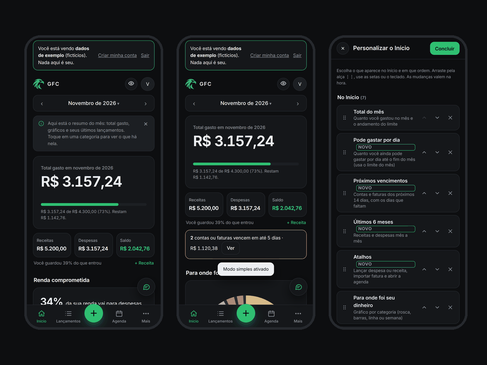
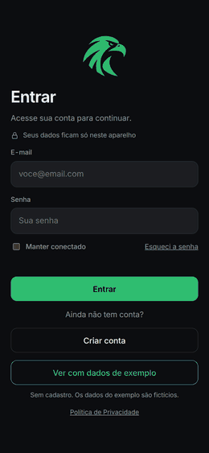

# GFC · Expense tracker

[](https://github.com/Gabrielgrc7/gfc-controle-de-gastos/actions/workflows/deploy.yml)
[](LICENSE)

[Português](README.md) · **English**

A personal expense tracker that runs in the browser, works offline and **keeps data only on the user's device**. No server, no national ID number, nothing is sent to the internet. The interface is in Brazilian Portuguese.

### 👉 [Open the app](https://Gabrielgrc7.github.io/gfc-controle-de-gastos/) and tap **"Ver com dados de exemplo"** (see it with sample data, no sign-up)





## Why
Most finance apps ask you to hand your data to a server. GFC does the opposite: **everything runs and stays in your browser**. A credit card invoice PDF is parsed right there (and then discarded); only the entries you confirm are saved, in a database on your own device.

## Features
- Expenses and income: one-off, installments and recurring, with free-form categories and a bank-style amount field.
- **Credit card invoice import from PDF** (Nubank and Nomad, detected automatically), plus OFX and CSV, with a review screen that shows whether the sum matches the invoice total.
- **Committed income**: shows what percentage of the month's income already goes to recurring expenses and installments, what is left, and how it evolves over the next months.
- Cards with limit, closing and due dates; invoices; bills to pay; calendar; reports; savings goals and per-category limits.
- **Create a category on the spot** from anywhere a category is chosen (new entry, history, invoice review and assistant).
- Chat assistant that understands sentences like "gastei 45 no mercado ontem" (runs on the device, asks for confirmation).
- **A Home screen your way**: **Full** mode (every block), **Simple** (only the essentials) or **Customize** (choose what appears and in what order by dragging, plus 7 extra blocks such as "Daily allowance"). See [`docs/07-modos-do-inicio.md`](docs/07-modos-do-inicio.md) (Portuguese).
- Guided tutorial, light/dark theme, PIN lock, no-sign-up sample mode.
- Privacy tools (Brazilian LGPD): consent, download my data, delete account, backup and restore, 30-day trash.
- Works offline after the first visit and can be installed on a phone's home screen.

## Technical decisions
| Decision | Why |
| --- | --- |
| Plain HTML, CSS and JavaScript, no framework | Few dependencies, fast, fully readable. The cost is a shared global scope across files (see "Known limits") |
| IndexedDB with an in-memory cache | A real browser database, larger than localStorage and transactional. Reads come from memory, writes go in the background, and failures are **shown to the user** instead of silently ignored |
| Data schema version and migrations | Changing the data format does not break existing users (`core/storage.js`) |
| pdf.js loaded on demand | The parser is 1 MB; nobody pays for it until they import an invoice |
| Regex-based invoice parsers | The PDF has no real table, only positioned text; each bank is a function in the `BANKS` registry |
| Web Crypto (PBKDF2) for password and PIN | No plain-text secrets, no external crypto library |
| Strict CSP (`script-src 'self'`) | No inline scripts; `check-release` verifies the code makes no network calls |
| Service worker | Offline use and installability |

## Stack
HTML5, CSS3, JavaScript (ES2022), IndexedDB, Web Crypto API, Service Worker, [pdf.js](https://github.com/mozilla/pdf.js), [Inter](https://rsms.me/inter/) font. Tooling: Node.js, jsdom, fake-indexeddb, Prettier, GitHub Actions.

## Run it
```
npm install
npm test             # builds and runs every test
npm run format       # Prettier
npm run build        # outputs dist/ (what gets deployed)
npx serve dist       # serves the site locally
```

## Tests
Over **41,000 automated checks** in 20 groups: dates and calendar (2000-2060), card invoice logic against a day-by-day simulation, the assistant (13k phrases), installments, currency fields, XSS, sign-up, the on-device database (migration, failures, two tabs), invoice parsing, and UI flows. They run in a simulated browser (jsdom). A separate end-to-end test in **real Chromium** (`tests/browser`) checks the layout at several screen sizes, offline mode, the security policy and PDF import. Test invoices are **fictional**.

## Known limits
- An "account" lives **only on the device** where it was created. Syncing across devices needs a server (see `docs/02`).
- Data in the browser is **not encrypted**; the in-app backup is the safety net.
- Verified on Chromium; Safari/iOS and Firefox still need testing.
- The privacy policy has **not been reviewed by a lawyer**.
- Source files share global variables; migrating to ES modules (Vite) is the natural next step.
- Dedicated invoice parsers: Nubank and Nomad. Other banks use a generic reader (check everything). See [CONTRIBUTING.md](CONTRIBUTING.md) to add one.

## License and credits
[MIT](LICENSE). Includes pdf.js (Apache-2.0) and the Inter font (SIL OFL 1.1): see [`THIRD-PARTY-NOTICES.md`](THIRD-PARTY-NOTICES.md).
