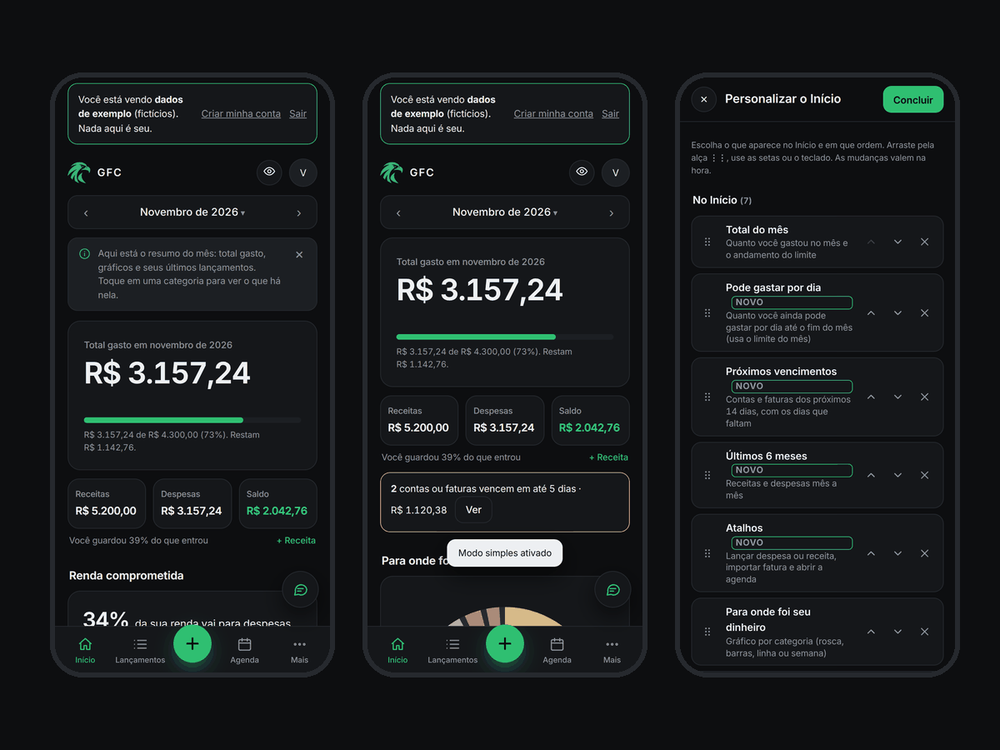
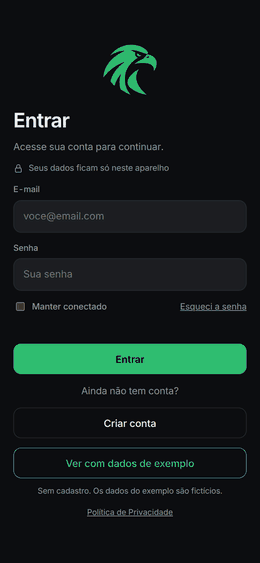

# GFC · Controle de gastos

[](https://github.com/Gabrielgrc7/gfc-controle-de-gastos/actions/workflows/deploy.yml)
[](LICENSE)

**Português** · [English](README.en.md)

App web de controle de gastos pessoais que roda no navegador, abre sem internet e **guarda os dados só no aparelho de quem usa**. Não tem servidor, não pede CPF e não envia nada para a internet.

### 👉 [Abrir o app](https://Gabrielgrc7.github.io/gfc-controle-de-gastos/) e tocar em **Ver com dados de exemplo** (sem cadastro)





## Por que existe
Quase todo app de finanças pede que você entregue seus dados a um servidor. O GFC parte do contrário: **tudo roda e fica no seu navegador**. A fatura em PDF é lida ali mesmo (e descartada), e só os lançamentos que você confirmar são guardados, num banco de dados do próprio aparelho.

## O que tem
- Lançamentos de despesa e receita, à vista, parcelados e recorrentes, com categorias livres e campo de valor estilo banco.
- **Importar fatura em PDF** (Nubank e Nomad, reconhecidas sozinhas), extrato OFX e CSV, com uma tela de conferência que mostra se a soma bate com o total da fatura.
- **Renda comprometida**: mostra quantos % da renda do mês já vão para despesas recorrentes e para parcelas, quanto sobra, e como isso evolui nos próximos meses.
- Cartões com limite, fechamento e vencimento; faturas; contas a pagar; agenda em calendário; relatórios; sonhos (metas) e limites por categoria.
- **Nova categoria na hora**, de qualquer lugar em que se escolhe categoria (novo lançamento, histórico, conferência da fatura e assistente).
- Assistente de chat que entende frases como "gastei 45 no mercado ontem" (roda no aparelho, com cartão de confirmação).
- **Início do seu jeito**: modo **Completa** (todos os blocos), **Simples** (só o essencial) ou **Personalizar** (você escolhe o que aparece e a ordem, arrastando, e ainda ganha 7 blocos novos, como "Pode gastar por dia"). Veja [`docs/07-modos-do-inicio.md`](docs/07-modos-do-inicio.md).
- Tutorial guiado, tema claro e escuro, bloqueio por PIN, modo de exemplo sem cadastro.
- LGPD: consentimento, baixar meus dados, excluir conta, backup e restauração, lixeira de 30 dias.
- Funciona sem internet depois da primeira visita e pode ser instalado na tela inicial do celular.

## Decisões técnicas
| Decisão | Por quê |
| --- | --- |
| HTML, CSS e JavaScript puros, sem framework | Poucas dependências, carrega rápido e dá para ler tudo. O custo é o escopo global compartilhado entre os arquivos (veja "Limites") |
| IndexedDB com cache em memória | Banco de verdade no navegador, maior que o localStorage e transacional. O app lê da memória e grava em segundo plano; se falhar, **avisa** em vez de fingir que salvou |
| Versão dos dados e migrações | Mudar o formato não quebra quem já usa (`core/storage.js`) |
| pdf.js carregado só quando alguém importa uma fatura | O leitor tem 1 MB; ninguém paga por ele sem usar |
| Leitor de fatura por expressões regulares | O PDF não tem tabela de verdade, só texto posicionado; cada banco é uma função no registro `BANKS` |
| Web Crypto (PBKDF2) para senha e PIN | Nada de senha em texto puro, sem biblioteca externa |
| Política de segurança estrita (CSP `script-src 'self'`) | Nenhum script dentro do HTML; o `check-release` garante que o código não faz chamadas de rede |
| Service worker | Abre sem internet e instala como app |

## Tecnologias
HTML5, CSS3, JavaScript (ES2022), IndexedDB, Web Crypto API, Service Worker, [pdf.js](https://github.com/mozilla/pdf.js) (Mozilla), fonte [Inter](https://rsms.me/inter/). Ferramentas: Node.js, jsdom, fake-indexeddb, Prettier, GitHub Actions.

## Estrutura
```
src/
  index.html        só a marcação das telas (sem código)
  css/styles.css    todo o visual
  js/core/          base: utilidades, banco de dados, datas, estado, criptografia, configurações
  js/features/      um arquivo por funcionalidade (assistente, calendário, cartões, demo, tutorial...)
  js/main.js        liga tudo ao abrir o app
  vendor/ fonts/    pdf.js e fonte Inter (licenças em licenses/)
tools/              build, verificação de publicação e personalização
tests/              testes automáticos (e tests/browser: teste em Chromium de verdade)
docs/               guias: segurança, servidor, IA, Open Finance, arquitetura
```
A ordem de carregamento fica em `src/js/order.json`; o mapa de cada arquivo está em [`docs/05-arquitetura.md`](docs/05-arquitetura.md).

## Como rodar
```
npm install
npm test             # monta e roda todos os testes
npm run format       # formata o código (Prettier)
npm run build        # gera dist/ (o que vai para a internet)
npx serve dist       # abre o site localmente
```
Para mexer sem montar nada, sirva `src/` (`npx serve src`): ele carrega os arquivos separados.

## Testes
Mais de **41 mil verificações automáticas** em 20 grupos: datas e calendário (2000 a 2060), fatura do cartão comparada com uma simulação dia a dia, assistente (13 mil frases), parcelas, valores em reais, XSS, cadastro, banco de dados (migração, falhas, duas abas), leitura de faturas e fluxos de tela. Rodam num navegador simulado (jsdom). Há também um teste de ponta a ponta em **Chromium real** (`tests/browser`), que confere visual em vários tamanhos de tela, modo offline, a política de segurança e a importação de PDF.

As faturas dos testes são **fictícias**. Para testar com a sua, coloque o PDF em `tests/fixtures/` (a pasta é ignorada pelo Git: nunca suba faturas reais).

## Publicar
O [`deploy.yml`](.github/workflows/deploy.yml) confere a formatação, roda os testes e publica `dist/` no GitHub Pages a cada push na `main`. Antes de tornar o repositório público, leia [`docs/01-antes-de-hospedar.md`](docs/01-antes-de-hospedar.md) e rode `npm run check:release:strict`.

## Limites conhecidos
- A conta vale **só no aparelho** onde foi criada. Sincronizar entre aparelhos exige um servidor ([`docs/02`](docs/02-servidor-e-sincronizacao.md)).
- Os dados no navegador **não são criptografados**. O backup em Mais, Dados é o que protege contra perda.
- Verificado em Chromium. Ainda falta testar em Safari/iOS e Firefox.
- A política de privacidade **não foi revisada por um advogado**.
- Os arquivos JavaScript compartilham variáveis globais; o próximo passo natural é migrar para módulos ES com Vite.
- Leitores de fatura dedicados: Nubank e Nomad. Outros bancos usam o leitor genérico (confira tudo). Faturas de exemplo (com dados trocados) ajudam a criar novos: veja [CONTRIBUTING.md](CONTRIBUTING.md).

## Privacidade em uma frase
Nada que você lança sai do seu navegador. A hospedagem do site vê, como em qualquer site, o endereço IP e o horário de quem baixou os arquivos, e nada mais.

## Licença e créditos
[MIT](LICENSE). Inclui pdf.js (Apache-2.0) e a fonte Inter (SIL OFL 1.1): veja [`THIRD-PARTY-NOTICES.md`](THIRD-PARTY-NOTICES.md).
